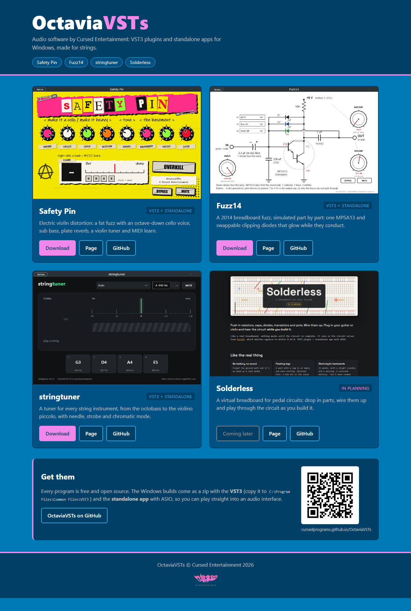
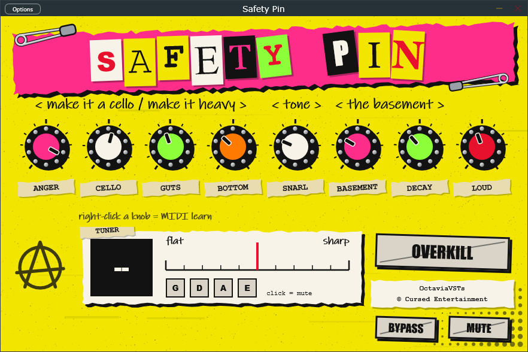
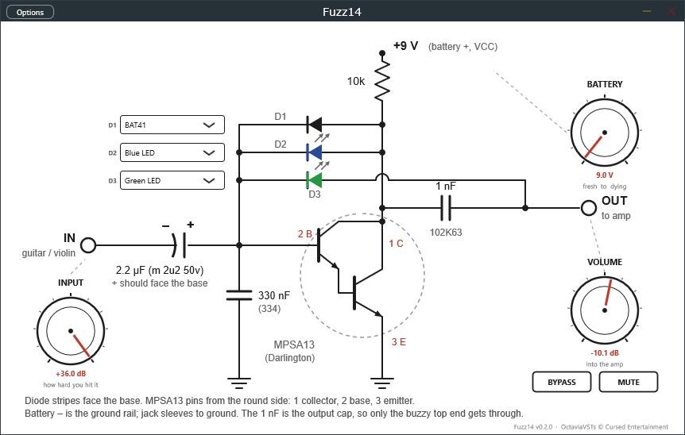
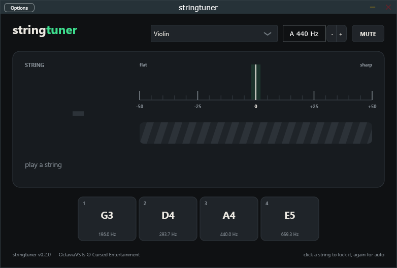
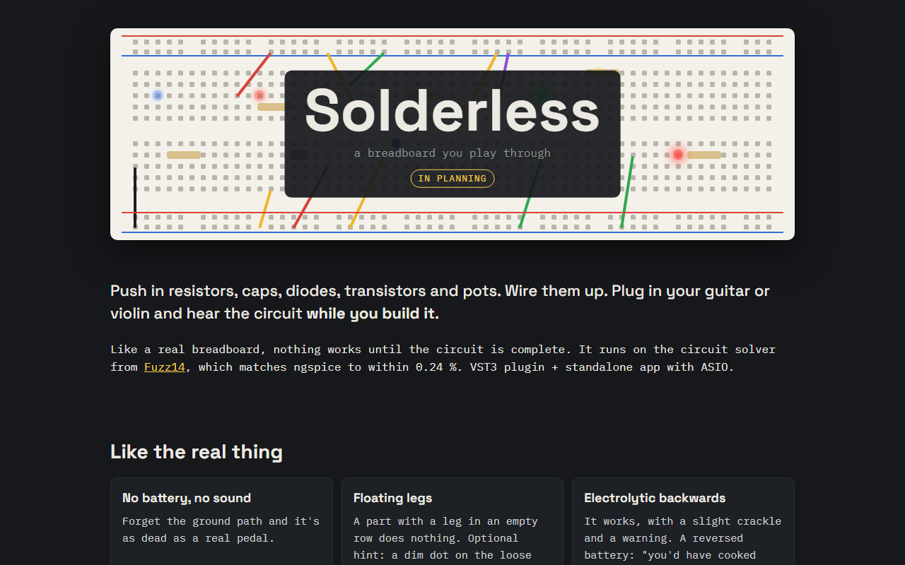

  

  
  
  

---

# OctaviaVSTs
### Audio software by Cursed Entertainment

**Website:** https://cursedprograms.github.io/OctaviaVSTs/

OctaviaVSTs is Cursed Entertainment's audio software label: VST3 plugins and standalone apps (with
ASIO) for Windows, made for guitar, violin and every other string instrument. All free and open source.

  

## The programs

### [Safety Pin](https://github.com/CursedPrograms/SafetyPin)
Electric violin distortion: a fat fuzz with an octave-down cello voice, sub bass, plate reverb, a violin tuner and MIDI learn.

[GitHub](https://github.com/CursedPrograms/SafetyPin) &middot;
[Website](https://cursedprograms.github.io/SafetyPin/) &middot;
**Download:** [Safety Pin v0.4.0](https://github.com/CursedPrograms/SafetyPin/releases/latest) (VST3 + standalone)

### [Fuzz14](https://github.com/CursedPrograms/Fuzz14)
A 2014 breadboard fuzz, simulated part by part: one MPSA13 and swappable clipping diodes that glow while they conduct.

[GitHub](https://github.com/CursedPrograms/Fuzz14) &middot;
[Website](https://cursedprograms.github.io/Fuzz14/) &middot;
**Download:** [Fuzz14 v0.2.0](https://github.com/CursedPrograms/Fuzz14/releases/latest) (VST3 + standalone)

### [stringtuner](https://github.com/CursedPrograms/stringtuner)
A tuner for every string instrument, from the octobass to the violino piccolo, with needle, strobe and chromatic mode.

[GitHub](https://github.com/CursedPrograms/stringtuner) &middot;
[Website](https://cursedprograms.github.io/stringtuner/) &middot;
**Download:** [stringtuner v0.2.0](https://github.com/CursedPrograms/stringtuner/releases/latest) (VST3 + standalone)

### [Solderless](https://github.com/CursedPrograms/Solderless)
A virtual breadboard for pedal circuits: drop in parts, wire them up and play through the circuit as you build it.

[GitHub](https://github.com/CursedPrograms/Solderless) &middot;
[Website](https://cursedprograms.github.io/Solderless/) &middot;
**In planning:** nothing to download yet.

## Installing
Each release is a zip with the **VST3** (copy the `.vst3` folder to `C:\Program Files\Common Files\VST3`)
and the **standalone app** (run the exe; pick your audio interface under Options > Audio/MIDI Settings).

  

---

 

OctaviaVSTs © Cursed Entertainment 2026

 

